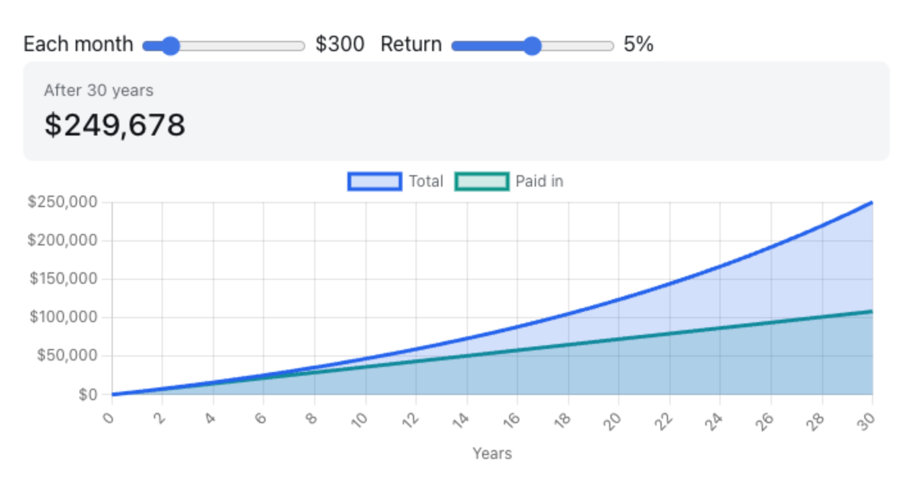
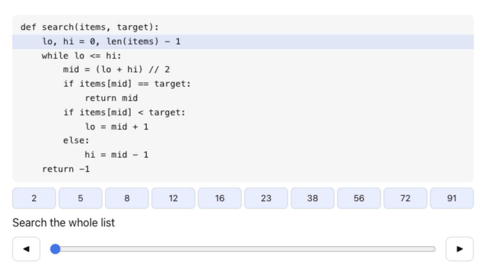
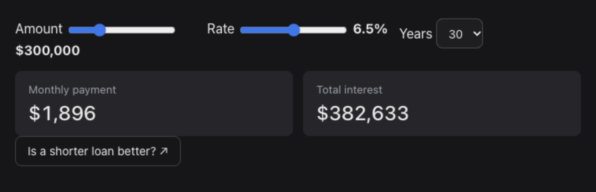
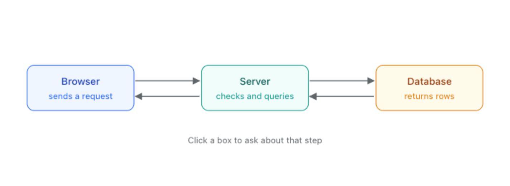
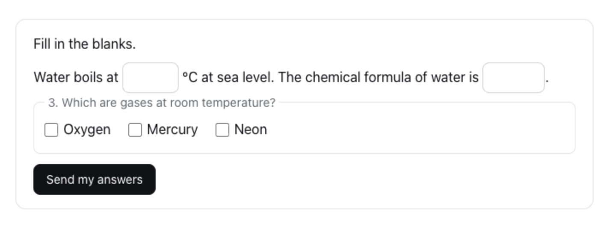
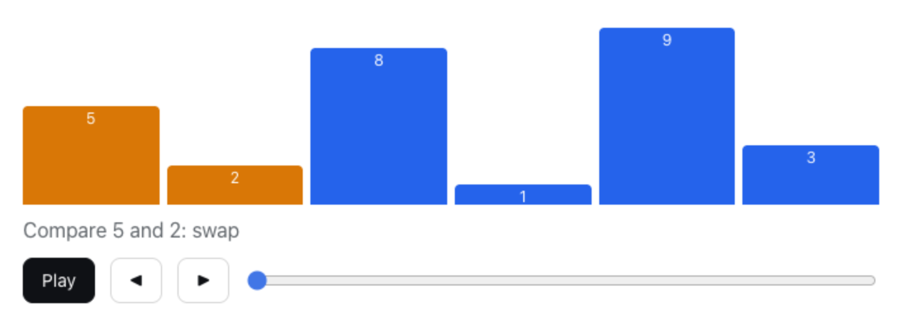
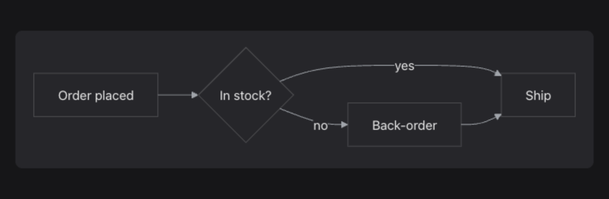

# 渐进式交互（dsh-intelligent-ui）

在 DeepSeek Harness 的对话里显示可交互的界面，做法和 Claude、ChatGPT 一样：模型写一个小网页（HTML、SVG、CSS 和 JavaScript），对话把它放进回复里的沙盒框架中运行，深浅色都跟随宿主样式。滑块、图表、示意图、模拟和测验都在你的浏览器里响应，不会再调用模型；点击可以把你的下一条消息发出去。

[English](README.md)

| | |
|---|---|
| 版本要求 | DeepSeek Harness **>= 0.2.1-rc.1**（低于 0.3.0） |
| 平台 | 网页版、macOS 桌面版、Windows 桌面版——同一份构建，两个桌面版加载的就是同一个网页客户端 |
| 已验证 | 新引擎：单元测试、构建产物在无头 Chrome 里的检查，以及 macOS 桌面版上的一次实测——模型写的界面画出来了，自带的 Chart.js 离线加载，按钮把下一条消息发了出去。网页版和 Windows 的实测还没做（见 `docs/VERIFY.md`） |
| 安装 | 设置 → 插件 → 添加插件 → `https://github.com/StarsHarryZhu/dsh-intelligent-UI`（需要 `PATH` 里有 `git`），然后重启 harness 并刷新页面 |

## 能画什么

下面每张图都是本插件画出的、内置技能里教的界面。



可以调的估算：拖动滑块，图表和总额立刻重画。



逐行演示算法，旁边是它处理的数据。



一个按钮替你问出下一个问题。



点击示意图的某个部分，就能问它是做什么的。



一次把所有答案交给模型批改的测验。



可以播放或单步的动画。



Mermaid 排版的流程图，用的是对话的配色。

## 工作方式

- 插件注册一个工具 `ui_render` 和一个技能 `dsh-intelligent-ui`。技能教模型什么时候用界面比用文字好、怎样设计、该用哪个库、出错了怎么修；插件管理页把它单独列为插件的一部分。
- 界面出现在回复里模型画它的位置，夹在前后两段文字中间；模型写的时候就在那里逐步显示，写完后脚本才开始运行。
- 显示之前，每段脚本都会做语法检查（只编译、不运行），模型在同一回合里就能改正。界面运行时出错，下面会有一个按钮，把错误发给模型重画。
- 你在界面里调过的东西（控件的值，以及界面自己选择记住的内容）保存在这个浏览器里，刷新或重启后保持原样。让模型修改界面时，它会画一个新版本，从你的设置开始，旧版本收起。
- 裸写的 HTML 就像宿主自己的样子：按钮、滑块、输入框、表格和代码都跟随对话主题；界面还能通过 CSS 变量拿到对话的配色，以及一套给示意图和图表用的色板。
- 带 `data-prompt` 的按钮、带 `data-send` 的表单，或脚本里的 `sendPrompt()`，都会通过对话自己的输入框发出你的下一条消息，而且只在你点击之后。
- 卸载后，所有会话照常打开，之前的调用显示为普通工具行。

## 库

插件自带 15 个库。界面照常写它们的 CDN 地址，插件会换成自带的副本，所以离线也能用，也不会向 CDN 发请求。每个库只在有界面用到时才下载。

| 库 | 版本 | 许可证 |
|---|---|---|
| Chart.js | 4.6.1 | MIT |
| ECharts | 5.6.0 | Apache-2.0 |
| D3 | 7.9.2 | ISC |
| topojson-client | 3.1.0 | ISC |
| KaTeX（含字体和 auto-render） | 0.16.47 | MIT |
| Three.js（r128，以及带 OrbitControls 的 0.160） | 0.128.0、0.160.1 | MIT |
| highlight.js | 11.12.0 | BSD-3-Clause |
| marked | 12.0.2 | MIT |
| Mermaid | 11.17.2 | MIT |
| math.js | 14.9.1 | Apache-2.0 |
| Tabler Icons（图标字体） | 3.52.0 | MIT |
| Matter.js | 0.20.0 | MIT |
| Tone.js | 14.9.17 | MIT |
| anime.js | 3.2.2 | MIT |

其他库从 cdnjs、jsDelivr、unpkg 或 esm.sh 加载。各库的许可证全文在 `lib/licenses/`。

## 安全

模型写的代码从不在对话页面里运行。每个界面运行在自己的沙盒框架里：

- 碰不到页面、页面的存储和你的会话；不能弹窗、不能让页面跳转，也用不了摄像头、麦克风和定位；
- 内容安全策略只允许它从插件自带的副本、四个代码 CDN 和 Google Fonts 加载，其他请求（包括把数据发到别的网站）一律拦截；
- 它只收到自己的源码、主题和它保存的内容，收不到令牌、会话 id 或别的界面的数据；
- 页面检查它发来的每条消息：只有你刚在这个界面里点击过，消息或链接才会发出；界面试图跳转到别处会被立即移除。

界面里的脚本仍可能很耗资源；万一卡住，刷新页面即可。

## 从 0.1.x 升级

早期版本用一种声明式语言画卡片。那些卡片现在显示它们保存的文字版本，并附一条说明；新的回答用新的界面。

## 开发

```sh
node scripts/link-dev.mjs   # 从同级 harness checkout 链接工具链
node scripts/vendor.mjs     # 下载并校验固定版本的库
node build.js               # 类型检查、构建并自检 bundle
node node_modules/vitest/vitest.mjs run
```

目录规则见 `AGENTS.md`，架构见 `docs/PRINCIPLE.md`，实测清单见 `docs/VERIFY.md`。

## 许可证

[MIT License](LICENSE) © 2026 Starfield。自带的库保留各自的许可证，见上表。
