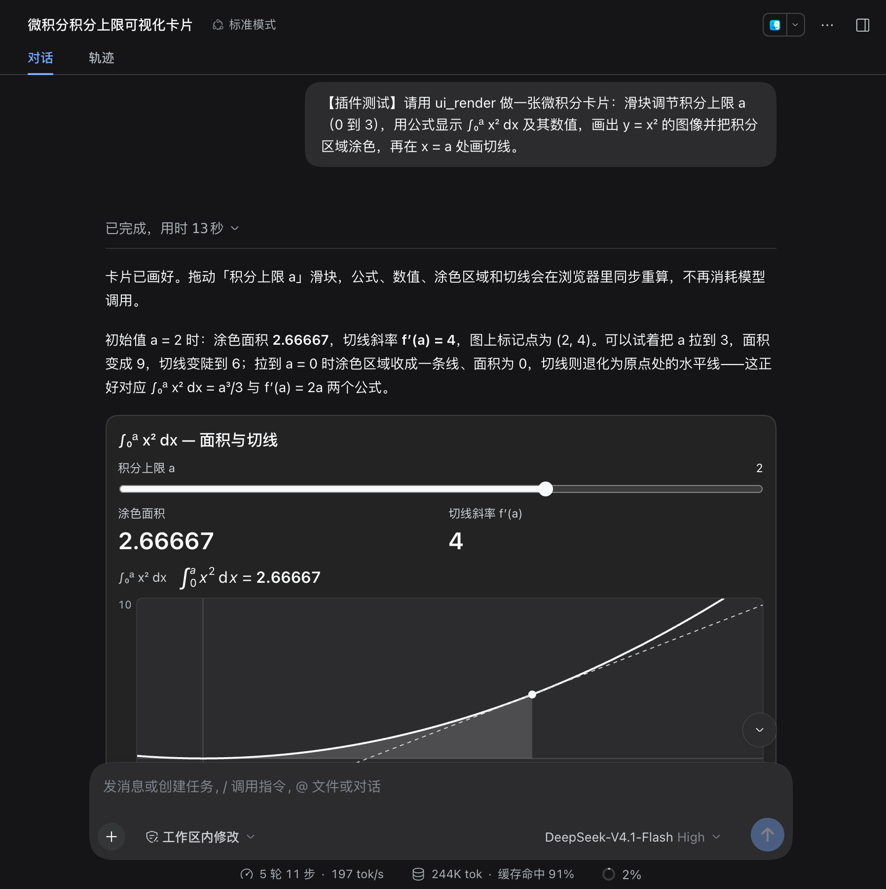
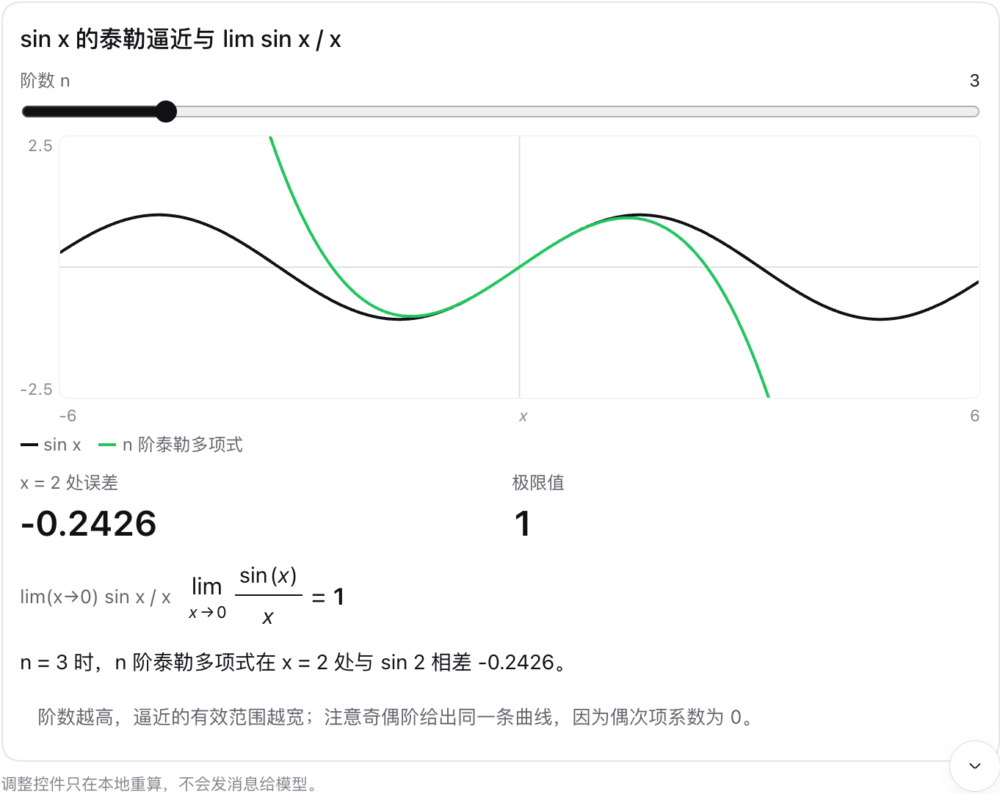

# dsh-intelligent-ui

在 DeepSeek Harness 的对话里显示可交互的卡片。模型写一段小小的界面程序，对话把它画成原生卡片：滑块、输入框、下拉选择、指标、表格、图表、函数图像、公式排版和作答按钮。拖动任何控件，数字都在你的浏览器里即时重算，不会再调用模型。

[English](README.md)



## 功能

- 注册一个工具 `ui_render`。模型把程序放在 `source` 里；插件按 26 个组件的固定目录校验它，并把编译后的程序随工具结果一起保存。
- 回复生成期间，卡片显示在工具行里（程序流式写入时有实时预览）；回合结束后，卡片显示在回复下方。
- 调整控件时所有数字在本地重算；只有点击按钮时才会把按钮上的文字作为你的下一条消息发出。
- 卡片里可以直接算数学：定积分（含无穷积分限）、导数、极限、求和与连乘、方程求根、泰勒多项式，并用 `plot` 画函数图像、用 `formula` 排版公式。算不准的值显示为“—”，绝不猜一个数；模型会拿到卡片算出的数字，所以回复和卡片一致。
- 附带一个技能 `dsh-intelligent-ui`，教模型什么时候该用卡片、怎么做好一张卡片；请求合适时模型会自己加载。
- 沿用宿主的主题、字体和语言，浅色、深色模式都适配。
- 从不执行模型写的代码：程序只是数据，只由插件自己的组件绘制。

程序示例：

```
@state a = 1 min=0 max=3 step=0.1
card "y = x² 下的面积"
  slider "积分上限 a" bind=a
  formula "integral(x^2, x, 0, a)" label="面积"
  plot fn="x^2" from=-0.5 to=3 shadeFrom=0 shadeTo=a mark=a tangent=true
  metric "精确值 a³/3" value=a^3/3 digits=6
```



## 卡片里能放什么

26 个组件，每一个都用宿主的主题 token、字体和 4px 栅格绘制：

| 分组 | 组件 |
|---|---|
| 布局 | `card` `col` `row` `grid` |
| 文本 | `title` `text` `badge` `callout` `divider` `link` `image` |
| 数据 | `metric` `progress` `table` `keys` `list` `steps` `chart` |
| 数学 | `plot` `formula` |
| 控件 | `slider` `numberInput` `textInput` `select` `checkbox` |
| 动作 | `button` |

[`docs/SAMPLES.md`](docs/SAMPLES.md) 里每个组件都有一张实际画出来的样张，附程序原文与实测结果。

## 安装

在 DeepSeek Harness 里打开 设置 → 插件 → 添加插件，从 `https://github.com/StarsHarryZhu/dsh-intelligent-UI`（或本地文件夹）安装。安装或重新构建后请重启 harness 并刷新页面。从 GitHub 安装需要 `PATH` 里有 `git`；安装过程不会构建任何东西。

然后提一个用卡片比文字更好回答的问题，例如：「按每席位 29 美元，算一下团队套餐每月多少钱，给我一个可以调席位数的滑块」，或者「画出 y = x³ − 3x，用滑块选切点并画切线」。

## 平台

网页版、macOS 桌面版和 Windows 桌面版运行的是同一个网页客户端，也加载本插件的同一个浏览器包，所以三端表现一致。有两点差异来自宿主本身：

- 桌面版有自己独立的插件 profile：即使网页版已经装过，也要在桌面版自己的 设置 → 插件 里再装一次。
- 桌面版默认使用“标准”转录视图，运行中回合的工具行是折叠的。回合结束后卡片出现在回复下方；想看实时预览，可以展开步骤，或在设置里切换到“详细”视图。

## 卸载

在 设置 → 插件 里停用或移除这个 bundle，然后重启。所有会话照常打开，之前的调用会显示为普通工具行。插件不新增任何会话事件类型。

## 兼容性

| 项目 | 状态 |
|---|---|
| Harness | DeepSeek Harness `0.2.x`（`engines.dsh` 为 `>=0.2.0-0 <0.3.0-0`） |
| 已实测 | 网页版 0.2.1-alpha.4，2026-10-16（见 `docs/VERIFY.md`） |
| 桌面版 | macOS 与 Windows 桌面版加载同一个包；检查清单见 `docs/VERIFY.md` |
| Node | `^22.19.0 || >=24.0.0` |

## 开发

```sh
node scripts/link-dev.mjs   # 从同级 harness checkout 链接工具链
node build.js               # 类型检查、构建并自检 bundle
node node_modules/vitest/vitest.mjs run
```

目录规则见 `AGENTS.md`，线上验证清单见 `docs/VERIFY.md`。

## 许可证

[MIT License](LICENSE) © 2026 Starfield.
