# 渐进式交互（dsh-intelligent-ui）

在 DeepSeek Harness 的对话里显示可交互的卡片。模型写一段小的界面程序，对话把它画成原生卡片；调整控件时，所有数字都在浏览器里重算，不会再调用模型。按钮会把上面的文字作为你的下一条消息发出。

[English](README.md)

| | |
|---|---|
| 版本要求 | DeepSeek Harness **>= 0.2.1-alpha.1**（低于 0.3.0） |
| 平台 | 网页版、macOS 桌面版、Windows 桌面版——同一份构建，两个桌面版加载的就是同一个网页客户端 |
| 已验证 | 网页版 0.2.1-alpha.4；macOS 和 Windows 桌面版 0.2.1-rc.2 |
| 安装 | 设置 → 插件 → 添加插件 → `https://github.com/StarsHarryZhu/dsh-intelligent-UI`（需要 `PATH` 里有 `git`），然后重启 harness 并刷新页面 |

## 工作方式

- 插件注册一个工具 `ui_render` 和一个技能 `dsh-intelligent-ui`，技能教模型什么时候用卡片比用文字好。模型不写 HTML 或 JavaScript：它写的程序按 31 个组件的目录校验，随工具结果一起保存。
- 回复生成时，卡片显示在工具行里；回复结束后，卡片显示在回复下方。调整控件时，所有数字都在本地重算。
- `player` 让卡片动起来：逐行演示代码执行、算法的每一轮、点沿曲线移动。播放在浏览器里进行，不会发消息给模型。
- 卡片能算定积分（含无穷积分限）、导数、极限、求和与连乘、方程求根和泰勒多项式。算不准的值显示“—”，不会给出猜测的数。
- 卸载后，所有会话照常打开，之前的调用显示为普通工具行。

## 开发

```sh
node scripts/link-dev.mjs   # 从同级 harness checkout 链接工具链
node build.js               # 类型检查、构建并自检 bundle
node node_modules/vitest/vitest.mjs run
```

目录规则见 `AGENTS.md`，线上验证清单见 `docs/VERIFY.md`。

## 31 个组件

每个组件一张卡片，由本插件按宿主的浅色主题绘制。每张卡片的程序原文见 [`docs/SAMPLES.md`](docs/SAMPLES.md)。

### `card` — 布局

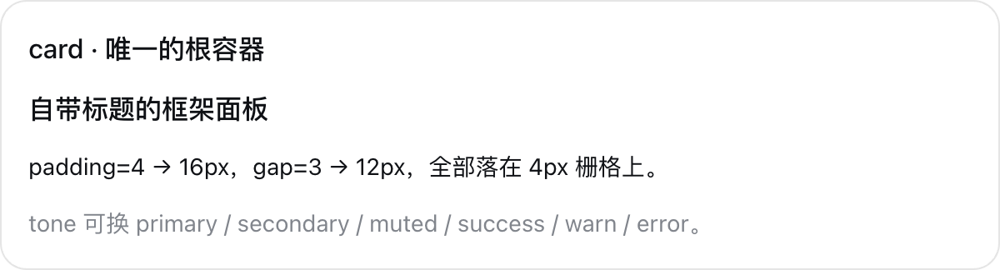

带边框的根容器，可设标题、内边距和间距。

### `col` — 布局


按阅读顺序垂直堆叠。

### `row` — 布局


等宽并排，窄屏自动换行。

### `grid` — 布局

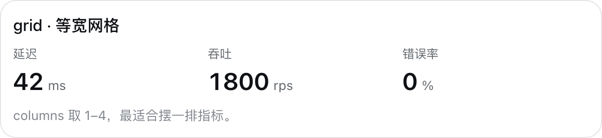

1 到 4 列的等宽网格。

### `tabs` — 布局

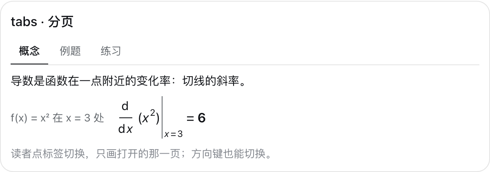

读者点击或用方向键切换的分页，只画打开的那一页。

### `tab` — 布局

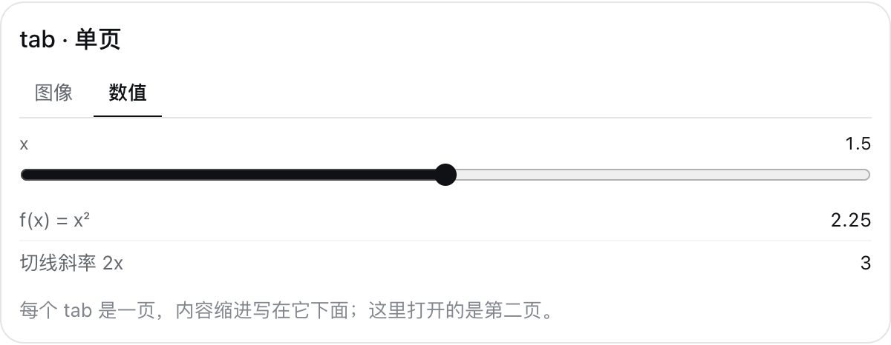

`tabs` 里的一页，以标题作标签；各页共用卡片的状态。

### `title` — 文本


标题行，五种字号。

### `text` — 文本


正文句子，可用 `{…}` 插入实时数值。

### `badge` — 文本


状态词，五种色调。

### `callout` — 文本


强调提示：假设、注意事项或下一步。

### `divider` — 文本

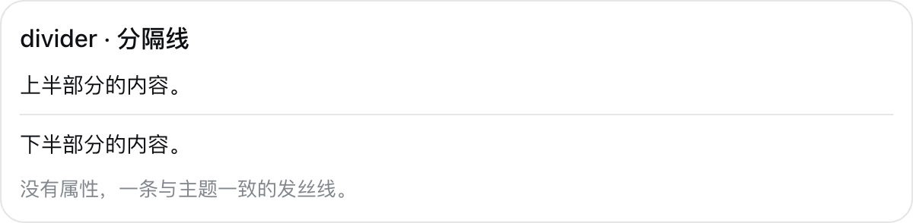

细分隔线。

### `link` — 文本


引用链接，读者点击才打开。

### `image` — 文本

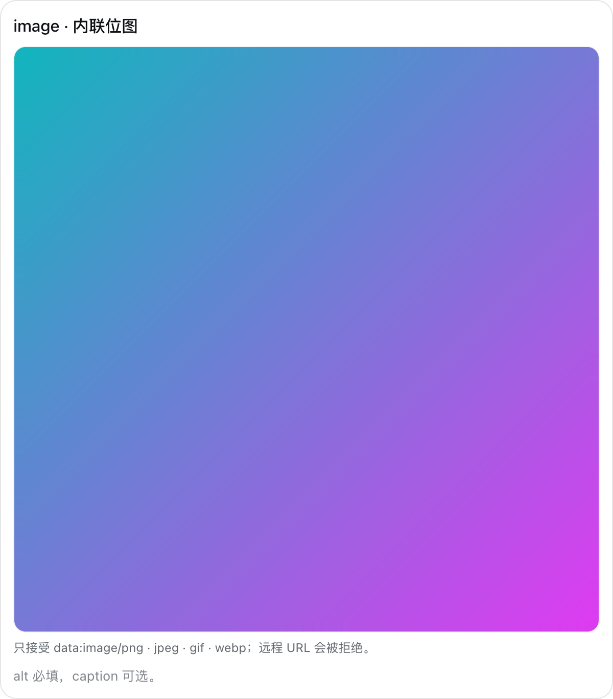

内联图片（只接受 `data:` 地址），带替代文字和说明。

### `metric` — 数据

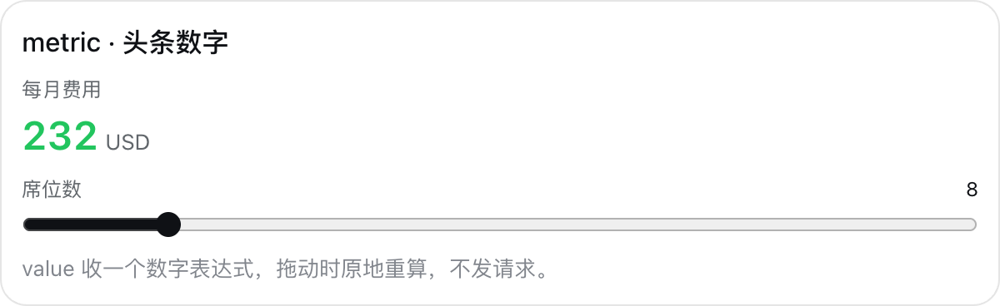

头条数字，控件一动就重算。

### `progress` — 数据

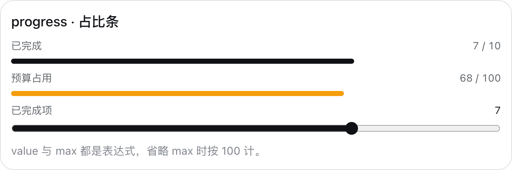

占比条。

### `table` — 数据

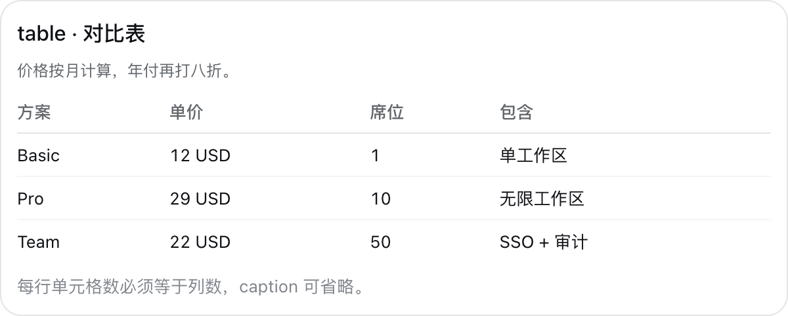

对比表；`current=` 高亮当前行，`sortable=true` 让读者按任意列排序。

### `keys` — 数据

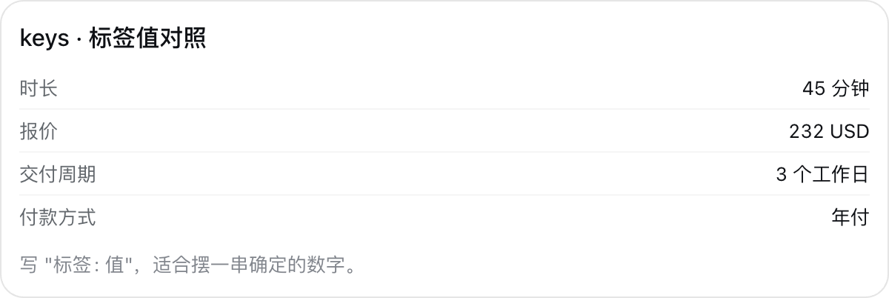

标签与数值对照。

### `list` — 数据


无序列表；`current=` 高亮当前项。

### `steps` — 数据


有序步骤；加上 `mono=true` 和 `current=` 就是高亮当前执行行的代码清单。

### `chart` — 数据

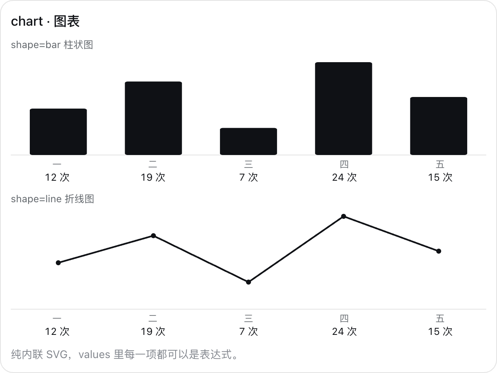

柱状图或折线图。

### `diagram` — 数据

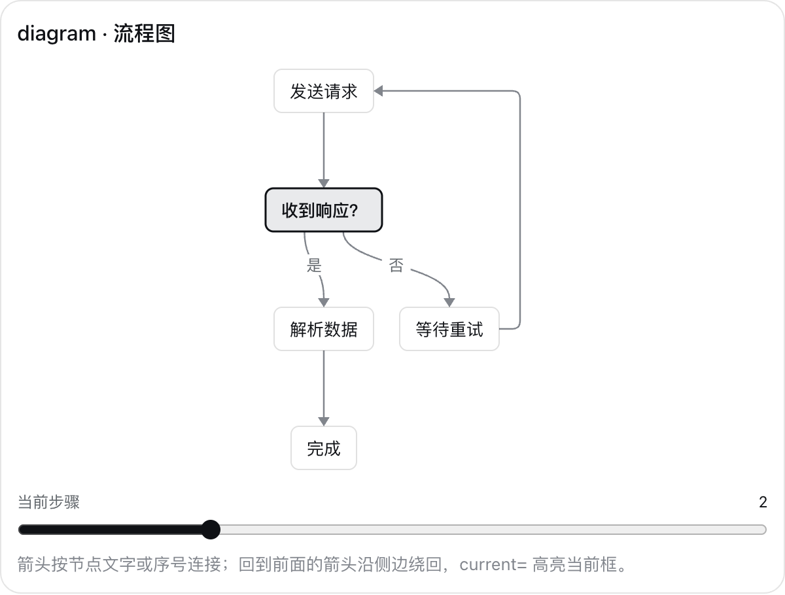

分层排布的流程图；回到前面的箭头沿侧边绕回，`current=` 高亮当前框。

### `plot` — 数学

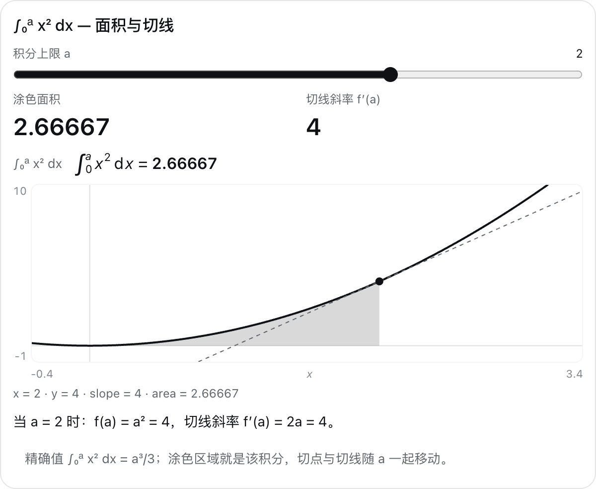

函数图像：标点、切线和积分阴影。

### `formula` — 数学

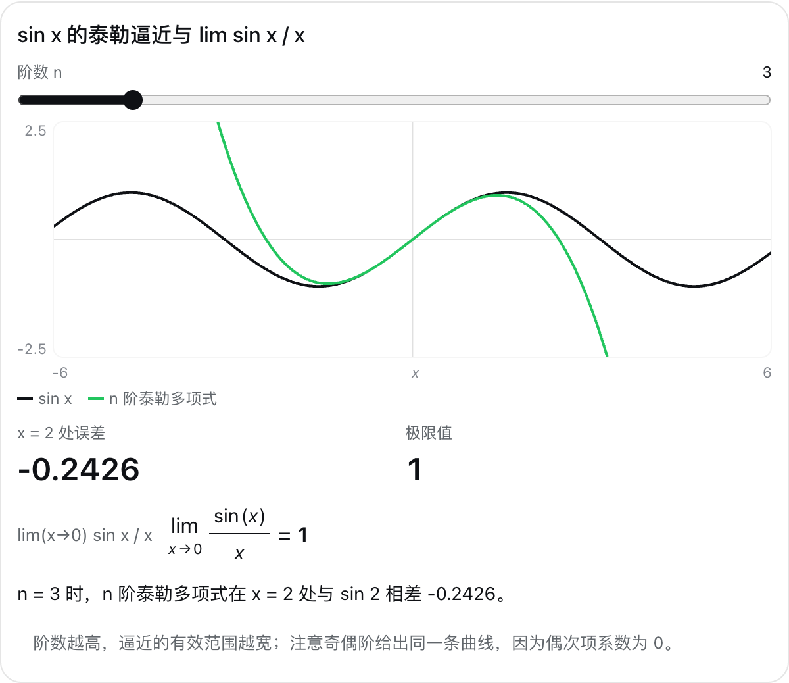

排版好的公式，后面跟实时数值。

### `slider` — 控件

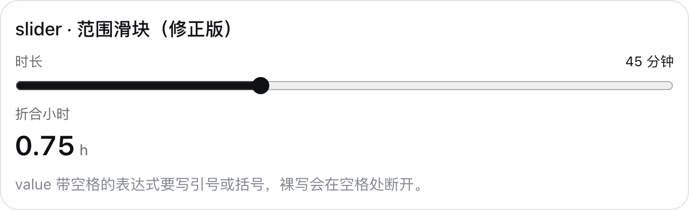

绑定数值的范围滑块。

### `numberInput` — 控件

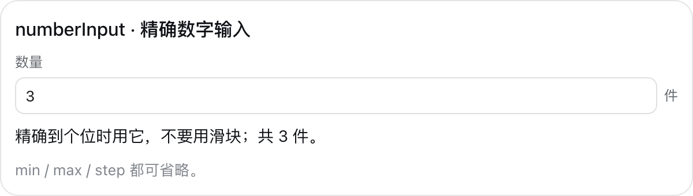

精确数字输入。

### `textInput` — 控件

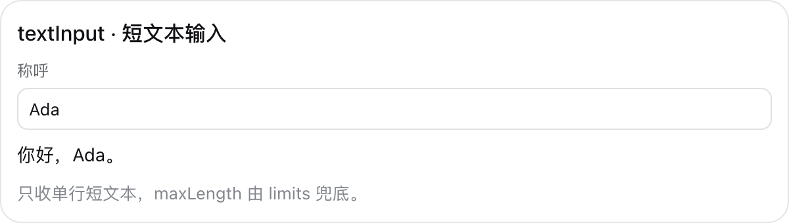

单行文本输入。

### `select` — 控件

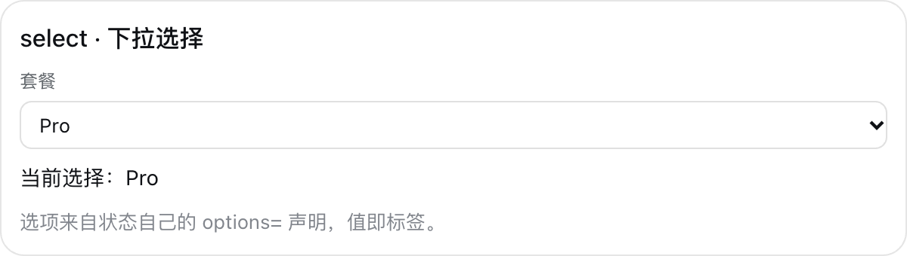

下拉选择。

### `checkbox` — 控件

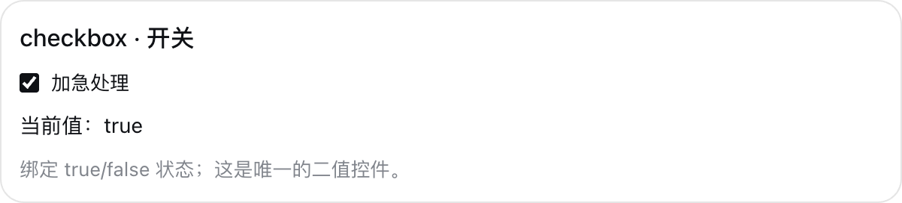

开关。

### `checklist` — 控件


可勾选的清单，显示完成数；`bind=` 把完成数交给卡片里的其他组件。

### `button` — 动作

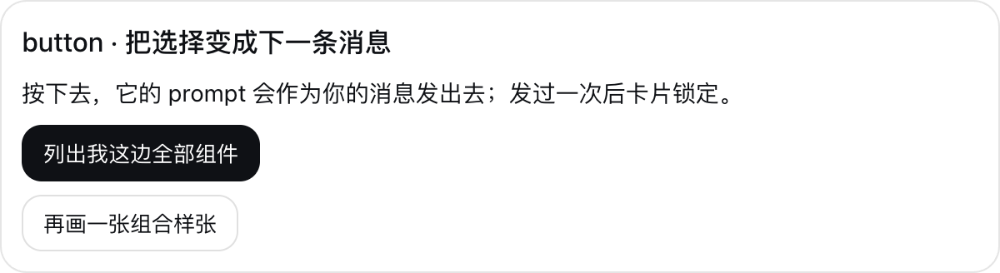

把按钮文字作为你的下一条消息发出，随后锁定卡片。

### `player` — 动画

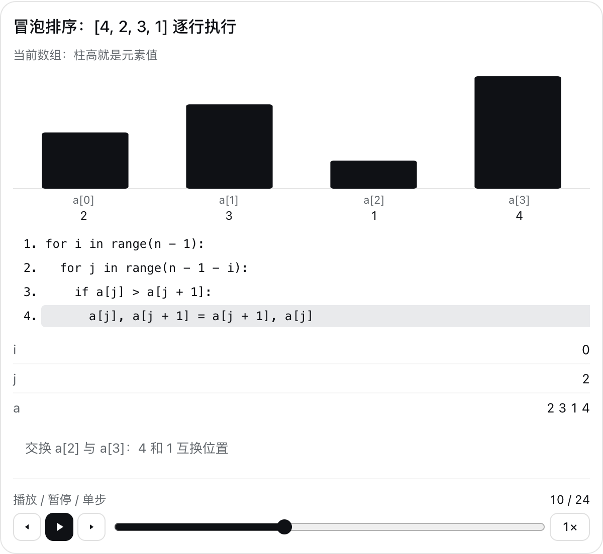

固定在卡片底部的播放条：让一个数值随时间播放、暂停、单步和拖动，倍速 0.5× 到 2×；引用它的内容逐帧更新。

## 许可证

[MIT License](LICENSE) © 2026 Starfield。
