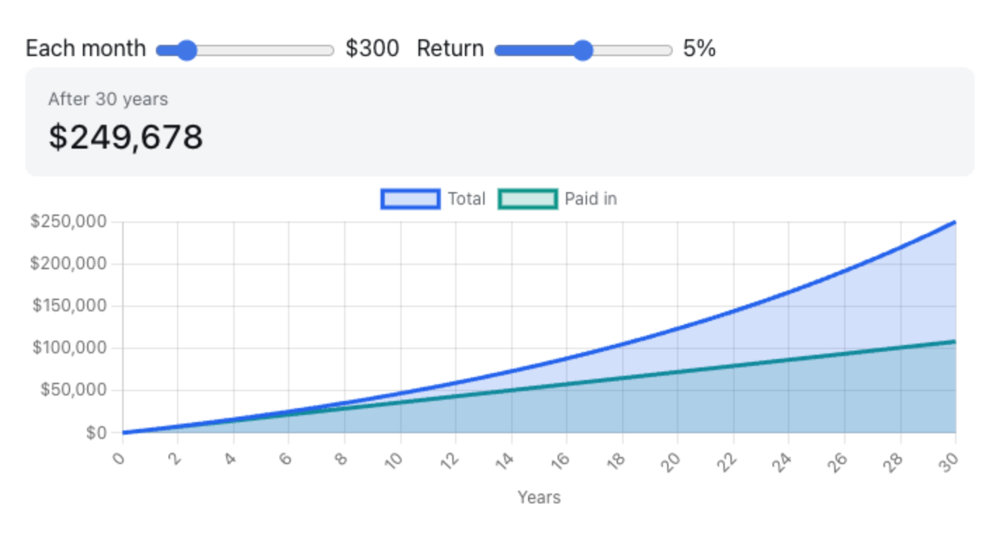
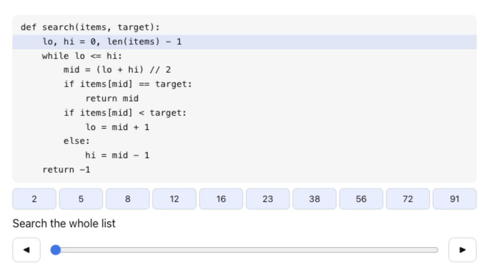
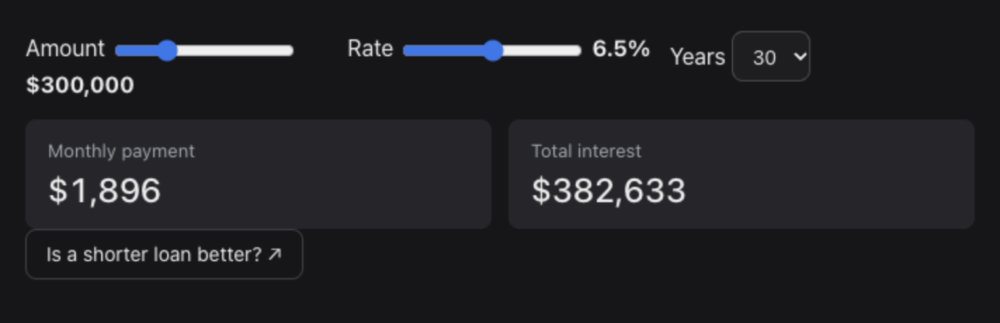
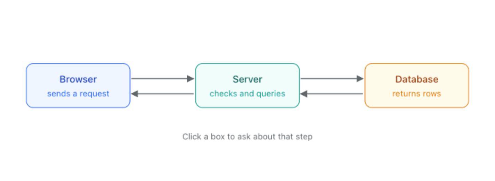
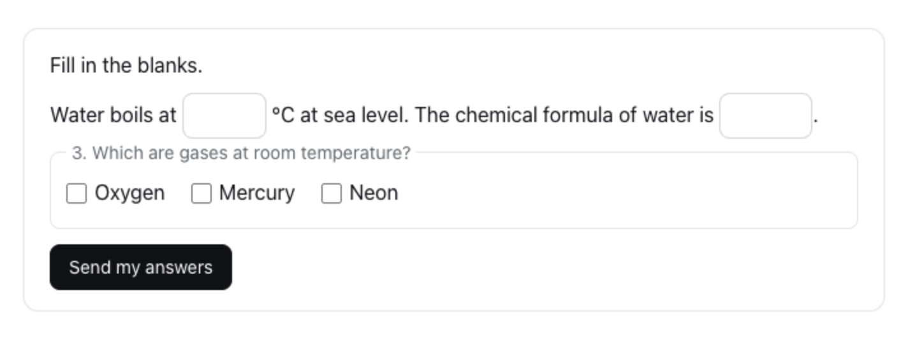
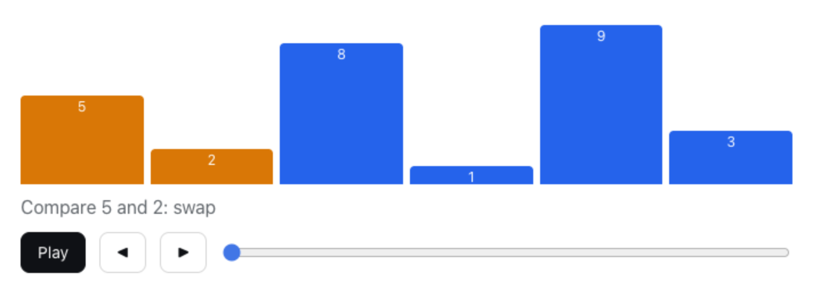
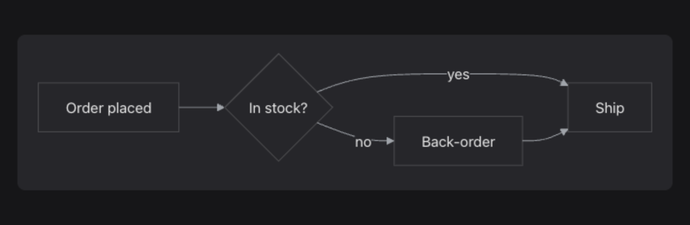

# dsh-intelligent-ui

Interactive widgets in DeepSeek Harness chats, the way Claude and ChatGPT draw them. The model writes a small web page — HTML, SVG, CSS, and JavaScript — and the chat runs it in a sandboxed frame right in the reply, styled like the host in both themes. Sliders, charts, diagrams, simulations, and quizzes respond in your browser without another model call, and a click can send your next message.

[中文](README-zh.md)

| | |
|---|---|
| Requires | DeepSeek Harness **>= 0.2.1-rc.1** (below 0.3.0) |
| Platforms | Web UI, macOS desktop app, and Windows desktop app — one bundle, because both desktop apps load the same web client |
| Verified | This engine: the unit suite, headless Chrome on the built bundle, and two live runs on the macOS desktop app — a model-written widget drew with its shipped Chart.js offline and its button sent the next message; later, three widgets stood inside the answer at their blocks and four redraws replaced earlier cards. Web UI and Windows live runs are pending (`docs/VERIFY.md`) |
| Install | Settings → Plugins → Add plugin → `https://github.com/StarsHarryZhu/dsh-intelligent-UI` (needs `git` on `PATH`), then restart the harness and reload the page |

## What it draws

Each image is this plugin drawing a widget its bundled skill teaches.



An estimate you adjust: the sliders redraw the chart and the total at once.



An algorithm traced line by line, with the data it works on.



A button that asks the follow-up question for you.



A diagram whose parts you click to ask about them.



A quiz whose answers go back to the model together.



An animation you play or step through.



A flowchart laid out by Mermaid, in the chat's colours.

## How it works

- The plugin registers one tool, `ui_render`, and one skill, `dsh-intelligent-ui`. The skill teaches the model when a widget beats prose, how to design one, which library fits, and how to fix one that failed; the Plugin Manager lists it as its own part of the plugin.
- A widget stands in the reply where the model drew it, between the text before it and the text after it, and builds up there while the model writes it. Its scripts run once it is complete. The model can also stand it anywhere inside its answer by writing a small ```widget block with the widget's id there; the widget moves into that spot and the block is not shown.
- Before a widget is shown, every script is checked for syntax errors — compiled, never run — so the model fixes a mistake in the same turn. If a widget fails while running, a button under it sends the error to the model, which redraws it.
- What you set in a widget — its controls and whatever it chose to remember — is kept in this browser, so a reload or a restart shows it as you left it. Asked to change a widget, the model draws a new version that starts from your settings, and the old one folds away.
- Bare HTML already looks like the host: buttons, sliders, inputs, tables, and code take the chat's theme, and widgets get its colours as CSS variables, with a palette for diagrams and charts.
- A button with `data-prompt`, a form with `data-send`, or `sendPrompt()` in a script sends your next message through the chat's own composer, only when you clicked.
- Uninstalling leaves every session opening as before; earlier calls show as ordinary tool rows.

## Libraries

Fifteen libraries ship with the plugin. A widget names them by their usual CDN address, and the plugin loads its own copy instead, so they work offline and nothing is fetched from a CDN. Each is downloaded only when a widget uses it.

| Library | Version | License |
|---|---|---|
| Chart.js | 4.6.1 | MIT |
| ECharts | 5.6.0 | Apache-2.0 |
| D3 | 7.9.2 | ISC |
| topojson-client | 3.1.0 | ISC |
| KaTeX (with fonts and auto-render) | 0.16.47 | MIT |
| Three.js (r128 and 0.160 with OrbitControls) | 0.128.0, 0.160.1 | MIT |
| highlight.js | 11.12.0 | BSD-3-Clause |
| marked | 12.0.2 | MIT |
| Mermaid | 11.17.2 | MIT |
| math.js | 14.9.1 | Apache-2.0 |
| Tabler Icons (webfont) | 3.52.0 | MIT |
| Matter.js | 0.20.0 | MIT |
| Tone.js | 14.9.17 | MIT |
| anime.js | 3.2.2 | MIT |

Any other library loads from cdnjs, jsDelivr, unpkg, or esm.sh. Their license texts are in `lib/licenses/`.

## Safety

The model's code never runs in the chat page. Each widget runs in its own sandboxed frame:

- no access to the page, its storage, or your session; no popups, no navigation of the page, no camera, microphone, or location;
- a content policy that lets it load only from the plugin's own copies, the four code CDNs, and Google Fonts — anything else, including sending data to another site, is blocked;
- it receives only its own source, the theme, and what it kept; never a token, a session id, or another widget's data;
- the page checks every message it sends: a message or a link goes out only right after you clicked inside that widget, and a widget that tries to navigate away is removed.

A widget can still run a heavy script; if one ever freezes, reload the page.

## Upgrading from 0.1.x

Earlier versions drew cards from a declarative language. Those cards now show the text version they stored, with a note; new answers use widgets.

## Development

```sh
node scripts/link-dev.mjs   # link the toolchain from the sibling harness checkout
node scripts/vendor.mjs     # download and check the pinned libraries
node build.js               # type-check, build, and self-check the bundle
node node_modules/vitest/vitest.mjs run
```

`AGENTS.md` holds the rules of the tree, `docs/PRINCIPLE.md` the architecture, and `docs/VERIFY.md` the live checklist.

## License

[MIT License](LICENSE) © 2026 Starfield. The shipped libraries keep their own licenses, listed above.
